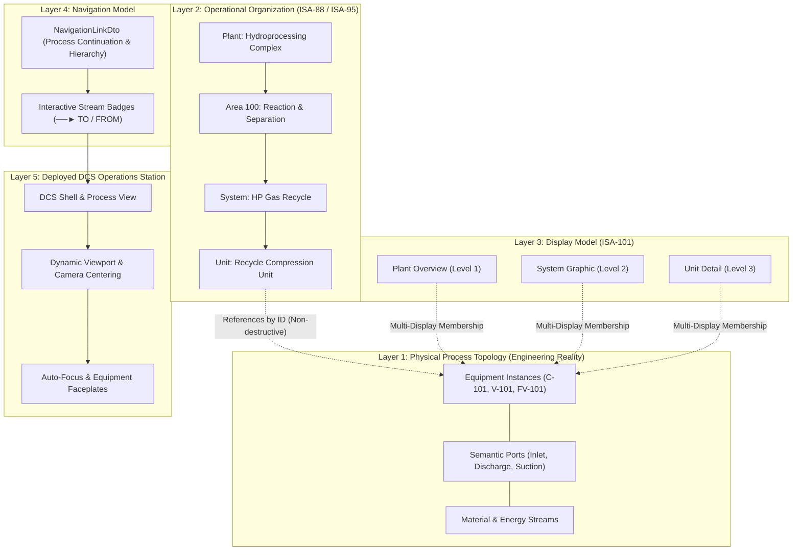

# NebuDCS Stage 14: Full Plant Modeling, Operational Mapping & Cross-Display Navigation Audit

## 1. Executive Summary & Quality Gate Verdict

- **Status**: PASSED / CERTIFIED
- **Date**: 2026-09-09
- **Scope**: ISA-88 / ISA-95 / ISA-101 Plant Modeling, System Mapping, Display Scoping, and Cross-Display Navigation.
- **Architectural Principle**:
  $$\text{Physical Plant Model} \longrightarrow \text{Operational Organization} \longrightarrow \text{Display Model} \longrightarrow \text{Navigation Model} \longrightarrow \text{Deployed DCS Operations}$$
- **Verification Summary**:
  - **Frontend Verification**: 18 test suites, 133 tests passing (`web/tests/system-mapping-navigation.test.ts` included).
  - **Production Build**: Clean build, 0 TypeScript errors.
  - **Backend Verification**: 6/6 topology validation tests, 9/9 server re-audit tests, and end-to-end REST API roundtrip acceptance tests passing (`stage_14_plant_modeling_navigation_tests.rs`).
  - **Zero Regressions**: Zero modifications to simulation loop, physics solver, or deterministic WebSocket telemetry.

---

## 2. Five-Tier Architectural Decomposition

### Layer 1: Physical Process Topology (Engineering Reality)
- The physical process model (`equipment`, `ports`, `streams`) is the authoritative engineering reality.
- Equipment instances exist once in `project.equipment` with physical coordinates, definition references, and thermodynamic parameters.
- No equipment is duplicated to represent different displays or operational groupings.

### Layer 2: Operational Organization (ISA-88 / ISA-95)
- Encapsulated within `PlantStructureDto` (`PlantAreaDto` $\rightarrow$ `PlantSystemDto` $\rightarrow$ `PlantSubsystemDto` $\rightarrow$ `PlantUnitDto`).
- Equipment assignment is purely relational via `equipment_ids: string[]`.
- Changes in operational structure do not alter physical process connectivity or stream definitions.

### Layer 3: Display Model (ISA-101)
- Displays are first-class domain entities (`DisplayDto`) with unique stable identifiers (`id`).
- Each display defines:
  - `display_type`: `plant_overview`, `area_overview`, `system_overview`, `unit_process_graphic`, `subsystem_graphic`.
  - `equipment_ids`: Explicit membership array allowing equipment to appear in multiple displays simultaneously (e.g. Unit Detail and System Overview).
  - `viewport`: Pre-configured coordinate offsets $(x, y)$ and zoom levels for optimal operator ergonomics.
  - `is_default`: Identifies the startup overview display.

### Layer 4: Navigation Model
- Formalized via `NavigationLinkDto`:
  - `source_display_id` & `source_element_id`
  - `target_display_id` & `target_element_id`
  - `behavior`: `focus_and_center`, `open_faceplate`, `switch_display_only`
- Integrated into stream continuation badges (`──► TO / FROM`):
  - Streams crossing display boundaries automatically resolve target equipment's parent display.
  - Clicking continuation badges triggers animated cross-display transition, viewport centering, element selection, and faceplate invocation.

### Layer 5: Deployed DCS Operations
- The operator station renders the authoritative geometry and executes navigation links without hardcoded display identifiers.
- `navigateUp()` traverses the ISA-88 hierarchy upwards (`unit_process_graphic` $\rightarrow$ `system_overview` $\rightarrow$ `area_overview` $\rightarrow$ `plant_overview`) dynamically resolved from `plant_structure`.
- `navigateHome()` immediately returns to the configured default plant overview.

---

## 3. Engineering Studio Authoring & Inspection

In the Engineering Studio:
1. **P&ID Flowsheet Canvas**:
   - Features a **Display Scope Filter** dropdown (`Full Physical Process Model` vs specific displays).
   - Elements outside the selected display are non-destructively dimmed (`opacity: 0.32`), giving engineers immediate visual confirmation of display boundaries.
2. **Property Inspector (Tab 6: System & Navigation)**:
   - **Operational Hierarchy**: Displays current Area, System, and Unit mapping with dynamic dropdown assignment.
   - **Display Membership**: Multi-selection checkboxes allowing immediate assignment of equipment across multiple displays.
   - **Physical Process Topology**: Real-time upstream inlet and downstream outlet connection topology.
   - **Cross-Display Navigation Links**: Table of outgoing links and interactive form to create new target links.
3. **Undo/Redo & State Management**:
   - `setEquipmentDisplays`, `setEquipmentOperationalMapping`, `addNavigationLink`, and `deleteNavigationLink` are fully integrated into the Studio Command pattern with complete undo/redo fidelity.

---

## 4. Backend Validation Guarantees

The validation engine (`crates/nebudcs-topology/src/validation.rs`) enforces strict design-time integrity rules before projects can be deployed:

| Rule ID | Severity | Description | Condition |
| :--- | :--- | :--- | :--- |
| `VLD-DSP01` | ERROR | Empty Display Identifier | `display.id.trim().is_empty()` |
| `VLD-DSP02` | ERROR | Duplicate Display Identifier | Multiple displays sharing the same ID |
| `VLD-DSP03` | WARNING | Missing Equipment Reference | Display references equipment not found in `project.equipment` |
| `VLD-NAV01` | ERROR | Unresolvable Target Display | Navigation link targets a non-existent display ID |
| `VLD-NAV02` | WARNING | Unresolvable Source Display | Navigation link originates from a non-existent display ID |
| `VLD-NAV03` | WARNING | Unresolvable Target Element | Navigation link targets an element not in target display |

---

## 5. Verification Results & Test Evidence

### Frontend Acceptance Test Suite
- Test File: `web/tests/system-mapping-navigation.test.ts`
- Total frontend tests: **133 / 133 passing** across 18 test files.
- Build Status: **Success** (`tsc --noEmit && vite build`).

### Backend Acceptance Test Suite
- Test File: `apps/nebudcs-server/tests/stage_14_plant_modeling_navigation_tests.rs`
- Validates:
  - Roundtrip persistence of `plant_structure`, `displays`, and `navigation_links` via REST API.
  - Schema migration and non-destructive serialization.
  - Automated project validation endpoint execution with display & navigation rule enforcement.
