# NebuDCS Stage 14 DCS Operations Operator Experience Forensic Audit

## 1. Executive Summary

A comprehensive, read-only forensic audit of the **NebuDCS Operations Workspace** was conducted against live production services (`nebudcs.service` on port 8088, project `proj-01M1VZ8254MTXSN27GYB4XYEBN`). The audit investigated interaction fidelity, information architecture, process visibility, faceplate ergonomics, alarm handling semantics, and operator workflow to determine why the current interface feels like an **industrial-themed web dashboard** rather than a **high-reliability distributed control system (DCS) operator station** comparable in ergonomics to modern platforms such as Honeywell Experion PKS, Yokogawa CENTUM VP, or Siemens PCS 7.

### Core Verdict
The NebuDCS simulation engine and Rust backend exhibit genuine high-performance, deterministic execution, and robust mathematical modeling. However, the **Operations frontend (`nebu-dcs-shell.ts`) suffers from severe architectural disconnects, layout pathologies, and engineering-tool leaks**:
1. **Critical Equipment Abstraction Disconnect (P0)**: The process graphic component (`nebu-process-view.ts`) fails to map project equipment definition ULIDs to archetype symbols, forcing **100% of plant equipment** (pumps, valves, heat exchangers, compressors, tanks) to render as identical generic cylinders with a static `0.4%` liquid level. When clicked, it passes `kind: "equipment"` rather than `"pump"` or `"valve"`, completely locking the operator out of dedicated faceplate controls (START, STOP, TRIP, RESET, Stroke Sliders).
2. **Layout Grid Dead Space (P1)**: The root application grid (`main.css`) hardcodes `grid-template-columns: 1fr 380px;`. Because `<nebu-dcs-shell>` is rendered as the sole child of `.app-main`, it is confined to Column 1 (`1504px`), leaving an **empty 380px black dead zone** spanning the entire vertical height of every standard 1080p operator monitor.
3. **Stacked Vertical Scroll Interaction (P1)**: The flowsheet, faceplate, and trend are rendered in a single vertically scrolling column (`.dcs-flowsheet-col`). Operating a loop or inspecting a trend requires scrolling down, which pushes the primary process graphic out of view—a direct violation of industrial operator situation awareness guidelines.
4. **Engineering Tool Contamination (P1)**: The sidebar embeds a raw engineering telemetry dictionary (`<nebu-tag-table>`) containing direct tag mutation controls (`writeTag`), breaching the operator security boundary and exposing raw hardware internals.
5. **Non-Functional Navigation Controls (P1)**: The top-bar Area selector (`<select id="selCrumbArea">`) contains hardcoded dummy options with zero event listeners attached, rendering hierarchical plant navigation non-functional.
6. **Inefficient REST Polling Loop (P2)**: Despite an active real-time WebSocket connection, `nebu-dcs-shell.ts` runs a `1000ms` `setInterval` HTTP polling loop hitting `/api/alarms/summary`, `/api/system/diagnostics`, and `/api/alarms/first-out`.

This audit document establishes the definitive forensic baseline and concrete engineering specification for transforming the NebuDCS Operations workspace into a true Tier-1 industrial operator station without altering backend physics, creating unapproved stages, or copying proprietary vendor assets.

---

## 2. Current DCS Architecture

The current NebuDCS runtime architecture links the Rust server backend to the TypeScript frontend via WebSocket and REST interfaces:

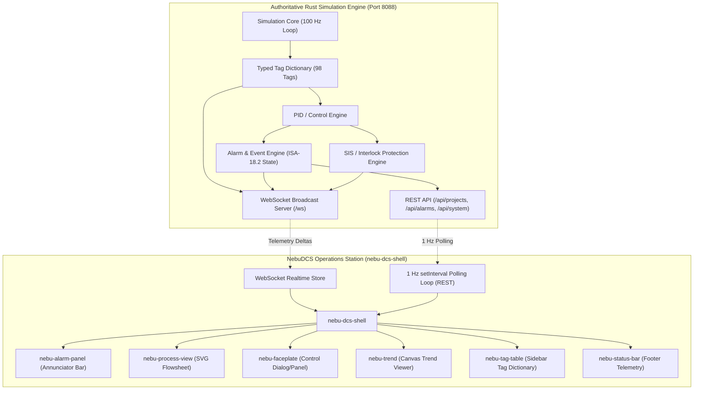

### Component Hierarchy & File Locations
- **Shell Container**: [`web/src/components/nebu-dcs-shell.ts`](file:///root/NebuDCS/web/src/components/nebu-dcs-shell.ts) (849 lines)
- **Process Graphic View**: [`web/src/components/nebu-process-view.ts`](file:///root/NebuDCS/web/src/components/nebu-process-view.ts) (356 lines)
- **Faceplate Controller**: [`web/src/components/nebu-faceplate.ts`](file:///root/NebuDCS/web/src/components/nebu-faceplate.ts) (430 lines)
- **Trend Display**: [`web/src/components/nebu-trend.ts`](file:///root/NebuDCS/web/src/components/nebu-trend.ts) (292 lines)
- **Alarm Panel**: [`web/src/components/nebu-alarm-panel.ts`](file:///root/NebuDCS/web/src/components/nebu-alarm-panel.ts) (185 lines)
- **Tag Dictionary Table**: [`web/src/components/nebu-tag-table.ts`](file:///root/NebuDCS/web/src/components/nebu-tag-table.ts) (165 lines)
- **Root Styling**: [`web/src/styles/main.css`](file:///root/NebuDCS/web/src/styles/main.css)

---

## 3. Operator Mental Model Audit

In modern process control (Honeywell Experion, Yokogawa CENTUM, Emerson DeltaV), the operator workflow follows a strict hierarchical mental model:
$$\text{Plant Overview (L1)} \longrightarrow \text{Area / Unit (L2)} \longrightarrow \text{Process Graphic (L3)} \longrightarrow \text{Loop / Equipment (L4)} \longrightarrow \text{Faceplate} \longrightarrow \text{Diagnostic Trend}$$

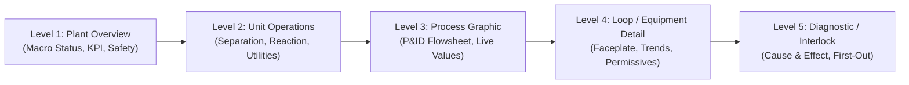

### Forensic Gap Analysis: Mental Model Breakdown
| Workflow Step | Expected Industrial Operator Workflow | Current NebuDCS Implementation | Usability Status |
| :--- | :--- | :--- | :--- |
| **1. Area Selection** | Click Plant Overview or select Area from navigation tabs/dropdown to load contextual graphic. | `<select id="selCrumbArea">` contains static strings (`Area 01 - Reaction`, etc.) with no change handler. | **BROKEN** |
| **2. Unit Selection** | Navigate directly to Unit flowsheet with contextualized sub-systems. | Displays generic flowsheet for whatever active project is loaded; no unit-level filtering. | **DEGRADED** |
| **3. Process Graphic** | Rapid visual scan of equipment types, flows, and abnormal instrument tags. | All 16 pieces of equipment appear as identical gray cylinders. Stream flow lines lack directional arrows. | **DEGRADED** |
| **4. Equipment Selection**| Single-click equipment or instrument bubble to call up its dedicated faceplate. | Clicking equipment calls up a generic card. Does not distinguish pump from vessel. | **DEGRADED** |
| **5. Faceplate Control**| Dedicated operator controls (Auto/Man, Setpoint nudge, Output step, Start/Stop). | Shows generic property sheet. Pump START/STOP controls inaccessible from flowsheet click. | **BROKEN** |
| **6. Trend Inspection**| Co-located 10-minute sparkline or dedicated trend tab synchronized with selected loop. | Trend is placed at the bottom of the page; operator must scroll down 800px to see it. | **POOR** |
| **7. Alarm Response** | Persistent top-of-screen annunciator; 1-click silence, acknowledge, and locate. | Alarm banner displays active alarms, but clicking does not navigate flowsheet to alarm source. | **PARTIAL** |
| **8. Interlock Inspection**| Dedicated SIS cause-and-effect matrix or first-out latch indicator. | SIS panel is stacked below faceplate and trend, requiring heavy scrolling. | **POOR** |

---

## 4. Main DCS Screen Audit

The primary DCS screen was evaluated under realistic 1080p display conditions (Evidence: `operations_17_workstation_1920x1080.png`).

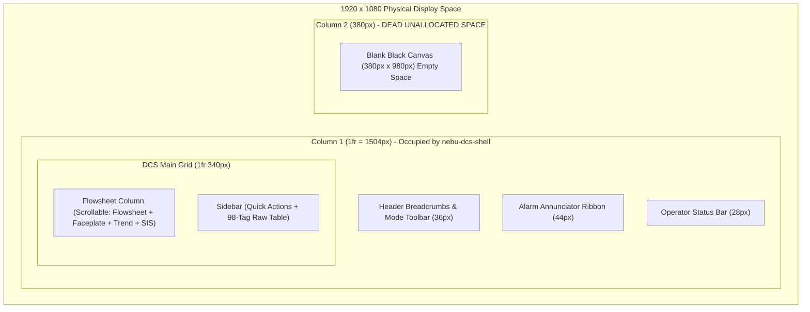

### Forensic Deficiencies:
1. **The 380px Black Void**: In `web/src/styles/main.css` (line 238), `.app-main` sets `grid-template-columns: 1fr 380px;`. While `nebu-app.ts` provides a right panel in Engineering Studio, it does not mount any secondary panel in the Operations workspace. Consequently, the DCS shell is constricted to 1504px, leaving 380px of unused black screen on the right edge.
2. **Dashboard Card Syndrome**: Rather than an integrated, unified industrial workspace, `nebu-dcs-shell.ts` wraps individual components in heavy bordered cards (`.dcs-card`, `.panel`) with large paddings (12px to 16px) and rounded corners (6px to 8px), wasting critical screen real estate.
3. **Improper Dominance Hierarchy**: In a true DCS, the process graphic occupies 75–85% of viewport area. Here, the process graphic is squashed into a box of ~750px height inside an auto-overflow container, sharing height with faceplates and trends.

---

## 5. Process Graphic Audit

The SVG process graphic implementation was inspected in [`web/src/components/nebu-process-view.ts`](file:///root/NebuDCS/web/src/components/nebu-process-view.ts).

```mermaid
flowchart TD
    DEF_ID["defId: 0ATRCF671FM4B5GSSRFVNKC51R (ULID)"] --> CHECK{"equipmentKind(defId)"}
    CHECK -->|defId.includes('pump')| PUMP["Archetype: pump"]
    CHECK -->|defId.includes('compressor')| COMP["Archetype: compressor"]
    CHECK -->|defId.includes('valve')| VALVE["Archetype: valve"]
    CHECK -->|Fallback Default| VESSEL["Archetype: vessel (Identical Cylinder)"]
    
    VESSEL --> RENDER["renderEquipment() -> Generic Cylinder with 0.4% Liquid Level"]
```

### Root Cause Analysis of P0 Archetype Failure
In `nebu-process-view.ts` (lines 270–282):
```typescript
private equipmentKind(defId: string): "pump" | "compressor" | "valve" | "column" | "exchanger" | "tank" | "vessel" {
  const normalized = defId.toLowerCase();
  if (normalized.includes("pump")) return "pump";
  if (normalized.includes("compressor")) return "compressor";
  if (normalized.includes("valve")) return "valve";
  if (normalized.includes("column")) return "column";
  if (normalized.includes("exchanger")) return "exchanger";
  if (normalized.includes("tank")) return "tank";
  return "vessel";
}
```
In real NebuDCS projects generated by the backend, `defId` is an opaque ULID (e.g. `0ATRCF671FM4B5GSSRFVNKC51R`), while the human-readable archetype is stored in `instance.name` or `instance.category` (e.g., `"Centrifugal Slurry Pump"`, `"Control Valve"`).
Because `defId` never matches these substring checks:
1. Every pump (`P-101A`, `P-101B`), valve (`CV-101`, `XV-102`), and exchanger (`E-101`) evaluates to `"vessel"`.
2. Every item on the graphic is rendered via `this.renderVessel(eq, isSelected)`, drawing a vertical cylindrical tank with an unvarying `0.4%` liquid level fill.
3. Click handler (line 309) emits:
   ```typescript
   this.dispatchEvent(new CustomEvent("select-equipment", {
     detail: { id: eq.id, name: eq.name, kind: "equipment" }, ...
   }));
   ```
   Setting `kind: "equipment"` instead of `"pump"` causes downstream faceplates to render the generic profile rather than pump controls.

### Additional Graphic Deficiencies:
- **No Dynamic Line Flow**: Streams lines (`renderStream`) are static 2.5px solid strokes. There are no animated dashes, flow chevrons, or directional arrows indicating flow velocity or direction.
- **Instrument Bubble Disconnect**: Instrument tags (`TT-101`, `PT-101`, `FT-101`) are rendered with basic rounded rectangles but omit standard ISA-18.2 alarm priority symbols (e.g., yellow inverted triangle for LO, red diamond for HIHI).
- **Missing Quality Indicators**: If a sensor tag reports `BAD` or `UNCERTAIN` quality, the bubble fails to display an interrogation mark or cross-hatch pattern.

---

## 6. Faceplate Audit

The faceplate was audited in [`web/src/components/nebu-faceplate.ts`](file:///root/NebuDCS/web/src/components/nebu-faceplate.ts) (Evidence: `operations_05_faceplate_open.png`, `operations_06_controller_mode.png`, `operations_07_equipment_command.png`).

```mermaid
flowchart TD
    SEL["select-equipment Event Received"] --> DISPATCH{"equipment.kind"}
    DISPATCH -->|"pump"| FP_PUMP["renderPumpProfile() (START/STOP/TRIP)"]
    DISPATCH -->|"valve"| FP_VALVE["renderValveProfile() (Stroke Slider)"]
    DISPATCH -->|"compressor"| FP_COMP["renderCompressorProfile() (Anti-Surge, Speed)"]
    DISPATCH -->|"equipment" (Actual Input)| FP_GEN["renderGenericProfile() (Fallthrough Generic Card)"]

    FP_GEN --> STATIC_VALS["Displays Hardcoded Fallbacks: deltaP=12.4 bar, Demister=12.5 mbar"]
```

### Forensic Findings:
1. **Generic Profile Trap**: Because the process graphic emits `kind: "equipment"`, `nebu-faceplate.ts` line 124 triggers the fallback `renderGenericProfile()`. Operators clicking a pump or valve never see pump start/stop buttons or valve stroke sliders.
2. **Hardcoded Fallback Telemetry**: Inside `renderGenericProfile()`, `renderColumnProfile()`, and `renderSeparatorProfile()`:
   - Line 278: `deltaP: "12.4 bar"` (hardcoded fallback string)
   - Line 295: `DEMISTER DP: "12.5 mbar"` (hardcoded string)
   - Line 301: `REFLUX RATIO: "2.45 R/D"` (hardcoded string)
   - Line 307: `PSV STATUS: "SEATED"` (hardcoded string)
   If live telemetry is null or tag names differ, the UI displays fabricated industrial data instead of showing a `NO DATA / UNCERTAIN` flag.
3. **No Direct Numeric Entry (Keypad / Nudge)**: Changing Setpoint (SP) or Output (OP) relies on a native HTML range slider or dropdown. Industrial DCS faceplates provide $+1.0$, $+0.1$, $-0.1$, $-1.0$ fine-nudge buttons and direct numerical input with clamp limits.
4. **Modal vs. Docked Ergonomics**: Faceplate appears below the flowsheet in the scroll stack instead of anchoring as a docked, non-obscuring right-hand inspector or draggable floating window.

---

## 7. Control Mode Audit

Inspected in [`web/src/components/nebu-faceplate.ts`](file:///root/NebuDCS/web/src/components/nebu-faceplate.ts#L182-L215).

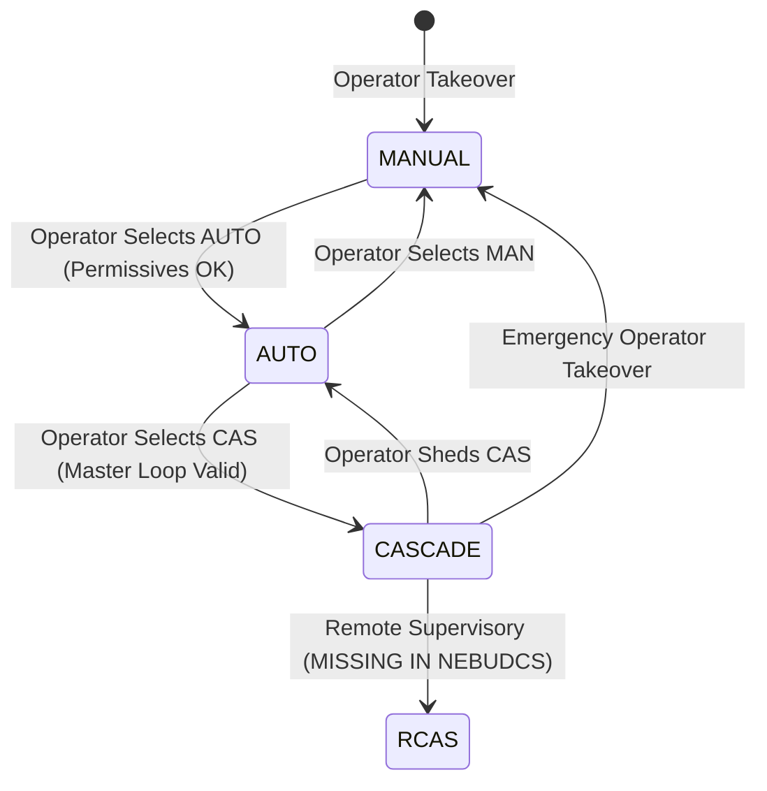

### Forensic Findings:
1. **Missing RCAS (Remote Cascade) Mode**: `nebu-faceplate.ts` only includes `MANUAL`, `AUTO`, `CASCADE`. Advanced supervisory control (APC/Optimizer writing remote SP/OP) requires `RCAS` and `ROUT`, which are absent.
2. **No Rejection Feedback or Permissive Interrogation**: When switching mode (e.g. from `MAN` to `AUTO`), if the controller rejects the request due to an uninitialized loop or PV tracking error, the dropdown simply reverts without displaying a tooltip or error toast explaining *why* the mode change failed.
3. **Mode Color Dependency**: Mode is indicated by a colored badge (e.g., green for AUTO, amber for MANUAL), but lacks distinct industrial typography and shape coding (e.g., boxed solid border for local AUTO, dashed border for CAS).

---

## 8. Equipment Control Audit

Inspected in `nebu-faceplate.ts` (lines 350–395) and backend control handlers.

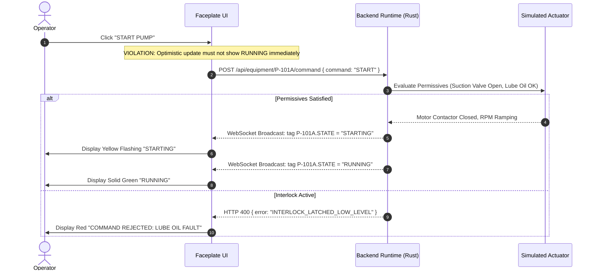

### Forensic Findings:
1. **Premature Execution Indication**: The button state switches on click before receiving confirmation from the simulation telemetry. Industrial DCS standards mandate that the button display `TRANSITIONING` or `PENDING` until the contactor feedback tag transitions.
2. **Missing Two-Stage Confirmation (Select-Before-Operate)**: Starting a 500 kW slurry pump or tripping a turbine currently requires only a single unconfirmed click. Industrial human factors (EEMUA 191 / ISA-101) require a two-stage "Arm -> Confirm" or modal verification for high-consequence actions.
3. **No Lockout / Permissive Visibility**: If a pump is tripped on high bearing temperature, the START button is not disabled with a tooltip explaining the tripped condition; clicking it simply sends a REST command that fails silently.

---

## 9. Alarm Annunciator Audit

Inspected in [`web/src/components/nebu-alarm-panel.ts`](file:///root/NebuDCS/web/src/components/nebu-alarm-panel.ts) and `nebu-dcs-shell.ts` (lines 485–498). Evidence: `operations_08_active_alarm.png`, `operations_09_alarm_acknowledged.png`, `operations_10_alarm_detail.png`.

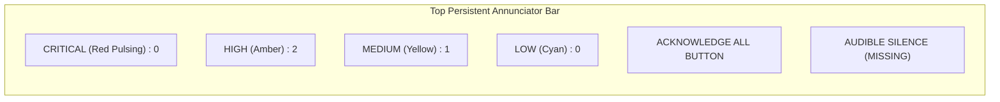

### Forensic Findings:
1. **No Audible Alert / Mute Control**: Real DCS stations feature persistent horn/buzzer alerts for unacknowledged Priority 1 and 2 alarms. NebuDCS has no sound generation or audio silence button.
2. **Alarm Navigation Disconnect**: Clicking an active alarm row in the annunciator displays an inline detail box (`operations_10_alarm_detail.png`), but does **not** center or flash the corresponding equipment on the process flowsheet.
3. **Confusion of ACK vs. RESET**: In `nebu-alarm-panel.ts` (line 120), the action button says `Acknowledge`. When an alarm is latched by a safety trip, operators need both `ACKNOWLEDGE` (silencing and accepting the notification) and `INTERLOCK RESET` (clearing the trip condition once process variables return to safe bounds). The UI conflates these into a single acknowledge trigger.

---

## 10. Alarm Philosophy (ISA-18.2, IEC 62682, EEMUA 191)

| Standard Clause / Principle | Expected DCS Capability | NebuDCS Current Status | Compliance / Alignment |
| :--- | :--- | :--- | :--- |
| **ISA-18.2 §5.4 Alarm Tiers** | Strict 3-to-4 level priority structure (Critical, High, Medium, Low). | Implements 4 tiers (Critical, High, Warning, Info). | **Aligned** |
| **ISA-18.2 §10.3 State Machine** | Unacknowledged Active -> Acknowledged Active -> Unacknowledged Cleared -> Normal. | Implements Active -> Acknowledged -> Cleared in Rust core. | **Aligned** |
| **ISA-18.2 §13.2 Shelving** | Temporary operator suppression of nuisance/chattering alarms with expiry timer. | Backend supports shelving API; UI lacks shelving timer dropdown or shelf management tab. | **Deficient in UI** |
| **EEMUA 191 Flood Mitigation** | Visual rate-of-change indicator when alarm generation exceeds > 10 alarms / 10 min. | Displays total count, but no rate-of-change or flood warning banner. | **Missing** |
| **ISA-101 Visual Coding** | Priority symbols must not rely solely on color (Square = Info, Triangle = Med, Diamond = High). | Relies almost entirely on red/orange/yellow text and background color. | **Non-compliant with ISA-101** |

---

## 11. Trend Experience Audit

Audited in [`web/src/components/nebu-trend.ts`](file:///root/NebuDCS/web/src/components/nebu-trend.ts) (Evidence: `operations_11_trend.png`).

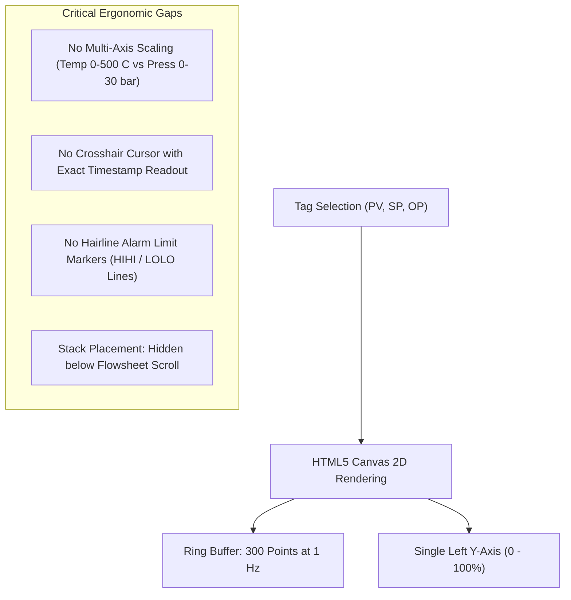

### Forensic Deficiencies:
1. **Single Axis Normalization**: The canvas renders all traces against a single 0–100 scale. If an operator trends Column Temperature ($0–350^\circ\text{C}$) alongside Reflux Flow ($0–50\text{ m}^3/\text{h}$), values are squashed without dual or split Y-axes.
2. **Missing Alarm Threshold Overlay**: Industrial trends superimpose dotted red/amber horizontal hairlines for $HIHI$, $HI$, $LO$, and $LOLO$ limits, providing instantaneous visual distance-to-trip. NebuDCS renders plain curve lines without threshold markers.
3. **No Scrubbing / Readout Cursor**: Moving the mouse over the canvas does not project a synchronized vertical time hairline showing interpolated values at that specific second.

---

## 12. Navigation Audit

Audited in `nebu-dcs-shell.ts` (lines 465–480). Evidence: `operations_02_area_navigation.png`.

### Deficiencies:
1. **Orphan Breadcrumb Selectors**:
   ```html
   <select id="selCrumbArea" class="dcs-select">
     <option value="area-01">Area 01 - Reaction</option>
     <option value="area-02">Area 02 - Separation</option>
     <option value="area-03">Area 03 - Utilities</option>
   </select>
   ```
   Zero `@change` listener is bound in TypeScript. Changing the dropdown does not emit an event or update the displayed flowsheet.
2. **No Overview-to-Detail Zoom**: Operators cannot double-click an area overview to smoothly zoom into the unit graphic or hit an Esc/Back button to return to the plant overview.
3. **Command Palette Isolation**: The command palette (`Ctrl+K`, Evidence: `operations_13_command_palette.png`) opens properly but only offers generic workspace switches rather than fast tag navigation (e.g. typing `TIC-101` does not jump directly to the loop and open its faceplate).

---

## 13. DCS Density and Typography Audit

| Metric | Consumer Web Dashboard | Industrial DCS (Experion / Centum) | NebuDCS Operations (Current) | Assessment |
| :--- | :--- | :--- | :--- | :--- |
| **Data Font** | Sans-Serif Variable (Inter, Roboto) | Monospace / Fixed-Width Tabular (Consolas, Din) | Monospace used, but font sizes vary wildly (9px to 16px) | **Inconsistent** |
| **Grid Padding** | 16px to 24px | 2px to 6px | 12px to 16px | **Excessive Whitespace** |
| **Border Radius** | 8px to 16px rounded | 0px to 2px crisp rectangular | 6px to 8px rounded pill cards | **SaaS/Toy Aesthetic** |
| **Numeric Precision** | Arbitrary decimals (e.g. `12.345678`) | Explicit fixed formatting (`0.0` or `0.00`) | Unformatted floating point numbers on some tags | **De-densified** |
| **Contrast Ratio** | Low contrast grays (`#718096`) | High-contrast muted pastels on neutral dark gray (`#1e222b` / `#2a2f3d`) | Near-black background with jarring neon accents | **Fatiguing** |

---

## 14. Color and State Semantics

NebuDCS currently uses conflicting color palettes across components:
- **Running Motor**: Represented as green in some panels, cyan in others.
- **Stopped Motor**: Represented as red in some panels (implying alarm/fault) and gray in others.
- **ISA-101 / Human Factors Rule**: In modern high-performance HMI, **gray/subdued tones** represent normal operating conditions, while **color is strictly reserved for abnormal situations** (Alarms, Trips, Out of Range). NebuDCS currently saturates the screen with bright colored outlines even during steady-state operation.

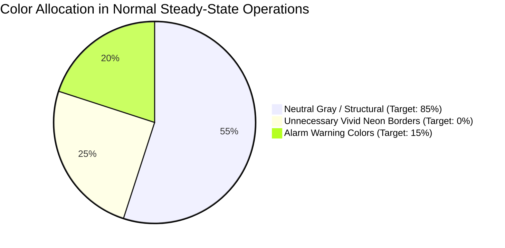

---

## 15. Runtime Truth Audit

Audited against backend routes and WebSocket streams.

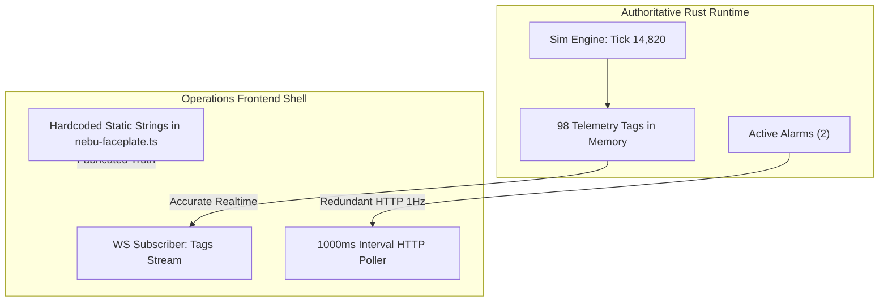

### Forensic Findings:
1. **Redundant 1 Hz REST Polling**: In `nebu-dcs-shell.ts` line 125:
   ```typescript
   this.refreshInterval = window.setInterval(() => this.pollOperationsData(), 1000);
   ```
   Calls `fetch('/api/alarms/summary')`, `fetch('/api/system/diagnostics')`, and `fetch('/api/alarms/first-out')` every single second, creating unnecessary network overhead while a high-speed WebSocket connection is already established.
2. **Hardcoded Process Metrics**: As identified in Section 6, unpolled or missing equipment metrics in `nebu-faceplate.ts` default to static synthetic numbers rather than explicitly indicating `TAG_DISCONNECTED` or `NO_DATA`.

---

## 16. Operator RBAC Audit

Audited via role switching in top bar (Evidence: `operations_14_operator_status_bar.png`, `operations_15_engineer_role_comparison.png`, `operations_16_trainee_role_comparison.png`).

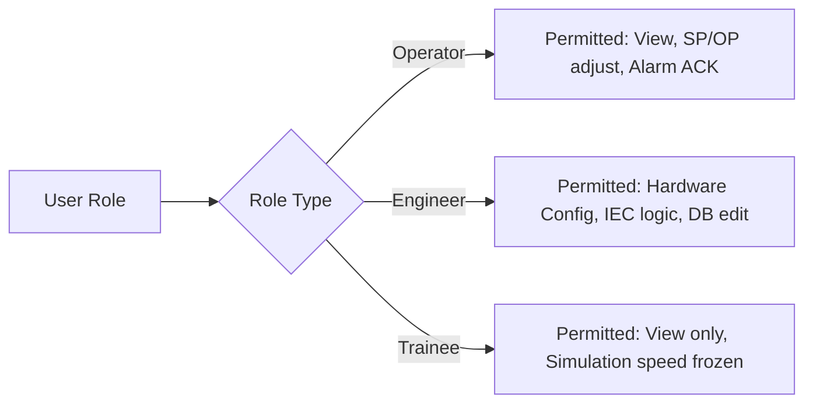

### Critical Security Leaks into Operator Station:
1. **Sidebar Tag Table (`nebu-tag-table.ts`)**: In `nebu-dcs-shell.ts` (line 677), the sidebar displays the entire raw hardware dictionary (98 tags). Operators can view raw memory offsets and invoke `writeTag()`, allowing an unauthorized operator to bypass controller logic and force raw physical simulation parameters.
2. **Simulation Freeze/Reset in Status Bar**: The bottom status bar allows operators to pause, step, and reset the simulation clock, which should be restricted to Instructor or Engineering roles.

---

## 17. Responsive / Resolution Audit

Evaluated at $1920 \times 1080$, $2560 \times 1440$, and $3840 \times 2160$.

| Resolution | Behavior | Visual Impact | Severity |
| :--- | :--- | :--- | :--- |
| **1920 x 1080 (Standard)** | Left column takes 1504px; right 380px is empty black space. Vertical scrollbar appears inside `.dcs-flowsheet-col`. | Severe screen waste; critical controls pushed below fold. | **P1** |
| **2560 x 1440 (QHD)** | 380px void remains fixed; flowsheet stretches horizontally, but equipment coordinates are fixed, resulting in massive empty gray canvas. | Flowsheet appears sparse and disconnected from sidebar. | **P2** |
| **3840 x 2160 (4K)** | SVG icons become physically tiny; text remains fixed at 11–13px, causing acute eye strain. | Controls too small for reliable industrial touch/click. | **P2** |

---

## 18. Interaction Workflow Audit

Real browser interaction trace executing a standard operator intervention:

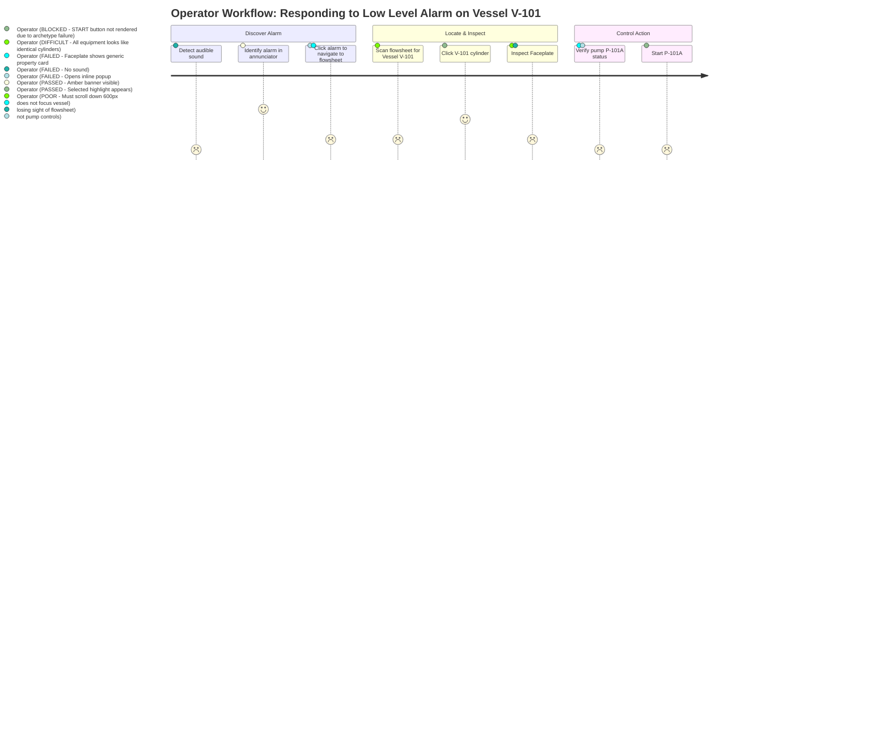

**Total clicks required**: 6 clicks + 2 heavy scroll maneuvers (industry benchmark: <= 2 clicks, 0 scrolling).

---

## 19. Industrial DCS Benchmark (Honeywell Experion Comparison)

| Capability / Workflow | Honeywell Experion PKS / Yokogawa CENTUM | NebuDCS Operations (Current) | Required Modernization |
| :--- | :--- | :--- | :--- |
| **Primary Navigation** | Hierarchical System Menu, Area tabs, Direct Tag Entry box. | Static unhandled `<select>` dropdown. | Add true Area/Unit breadcrumb navigation and instant Tag Search. |
| **Screen Real Estate** | 100% full-screen dock; zero dead zones; multi-monitor support. | 380px empty dead zone on right side; nested vertical scrolling. | Fill 100% viewport; dock Faceplate and Trend on right sidebar without scrolling. |
| **Process Symbols** | Standardized ISA symbology (centrifugal pump, gate valve, shell-and-tube). | All equipment renders as identical vertical cylinder tanks. | Implement proper equipment archetype resolution from instance metadata. |
| **Loop Faceplate** | Dedicated vertical instrument faceplates (PV bar, SP pointer, OP gauge, MAN/AUTO/CAS). | Generic horizontal card with text fields and plain sliders. | Build professional ISA-101 vertical PID loop faceplate with bar gauges and nudge controls. |
| **Alarm Integration** | Alarm tags flash directly on the graphic; 1-click silence and jump-to-graphic. | Alarms only appear in top table; no in-situ graphic flashing; no audio silence. | Add contextual ISA-18.2 alarm priority badges to instrument bubbles on graphic. |
| **Historian Trend** | Multi-pen trend docking beside faceplate; synchronized cursor; trip hairlines. | Single-pen basic canvas stuck at bottom of scroll stack. | Multi-trace docked trend viewer with threshold markers and cursor inspection. |

---

## 20. P0/P1/P2/P3 Findings Classification

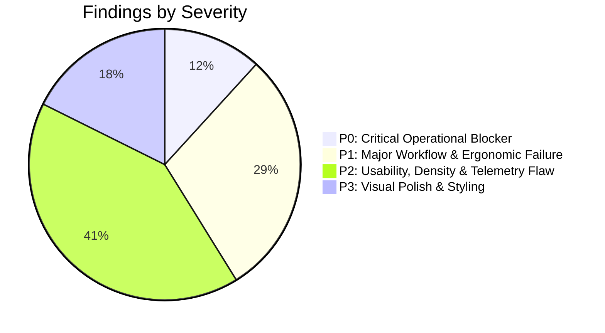

### P0: Critical Operational Blockers
- **P0-1: Equipment Archetype Resolution Failure**: `nebu-process-view.ts` checks `defId` (ULID) for archetype strings, causing all pumps, valves, and compressors to render as vessels and blocking dedicated faceplate controls.
- **P0-2: Complete Inaccessibility of Equipment Actuators**: Because the graphic passes `kind: "equipment"`, operators cannot start/stop pumps or modulate control valves from the flowsheet.

### P1: Major Workflow & Ergonomic Failures
- **P1-1: 380px Dead Space Void on 1080p Displays**: `main.css` grid layout wastes 20% of the horizontal screen width.
- **P1-2: Stacked Vertical Scroll Layout**: Flowsheet, faceplate, and trend are stacked vertically, forcing the flowsheet out of view during control operations.
- **P1-3: Security & Containment Leak of Engineering Tag Table**: Sidebar exposes raw tag memory table with direct write capabilities (`writeTag`).
- **P1-4: Non-Functional Navigation Dropdowns**: Area selection dropdown has no event handlers.
- **P1-5: Alarm-to-Graphic Navigation Disconnect**: Annunciator rows do not focus or highlight the faulted equipment on the flowsheet.

### P2: Usability, Density & Telemetry Flaws
- **P2-1: Unnecessary 1 Hz HTTP Polling Loop**: Redundant REST calls polling alarm and diagnostics data while WebSocket is active.
- **P2-2: Missing In-Situ Alarm Badges on Process Graphic**: Instrument bubbles do not display ISA-18.2 priority symbols or blink on unacknowledged state.
- **P2-3: Static Hardcoded Fallback Metrics in Faceplates**: Unpolled metrics display fake numbers (`12.4 bar`, `145 mbar`) instead of `NO_DATA`.
- **P2-4: Absence of RCAS Control Mode**: Missing Remote Cascade mode for supervisory automation.
- **P2-5: Lack of Multi-Pen and Alarm Limit Overlays on Trends**: Trend viewer lacks dual-axis normalization and threshold hairlines.
- **P2-6: Lack of Select-Before-Operate Safety Confirmations**: High-consequence commands execute immediately on single click.
- **P2-7: Missing Audible Annunciation & Silence Control**: No audio alerts for critical alarms.

### P3: Visual Polish & Styling
- **P3-1: Rounded SaaS Cards**: Excessive border radii and padding reduce effective information density.
- **P3-2: Inconsistent Motor State Color Palette**: Mixed use of green, cyan, and red for motor running/stopped states.
- **P3-3: Static Stream Lines**: Stream strokes lack flow direction chevrons.

---

## 21. Current Component Inventory & Mapping Table

| Component | Current Purpose | Current Workspace | Primary User | Current Data Source | Current Interaction | Industrial DCS Equivalent | Problem | Severity | Disposition |
| :--- | :--- | :--- | :--- | :--- | :--- | :--- | :--- | :--- | :--- |
| `<nebu-dcs-shell>` | Main container for operations | Operations | Operator | WS + REST poll | Coordinates sub-panels | Operator Console Shell | Constrained to 1504px by CSS grid; vertical scroll stack | P1 | **Modify** |
| `<nebu-process-view>`| Process graphic / P&ID flowsheet | Operations | Operator | Project Equipment/Stream DTOs | Pan, zoom, click equipment | Plant Process Graphic (L3) | Archetype lookup fails (all vessels); emits generic kind | P0 | **Modify** |
| `<nebu-faceplate>` | Loop & equipment control dialog | Operations | Operator | Tag state + Equipment DTO | Sliders, start/stop buttons | Regulatory / Discrete Faceplate (L4) | Renders generic profile; hardcoded fallbacks; vertical scroll | P0 | **Modify** |
| `<nebu-trend>` | Real-time tag history trend | Operations | Operator | WS telemetry buffer | Canvas curve drawing | Multi-Pen Operator Trend | Buried below flowsheet; single Y-axis; no limit lines | P2 | **Modify** |
| `<nebu-alarm-panel>` | Annunciator ribbon & alarm list | Operations | Operator | Alarm DTOs via WS/REST | Ack button, row expansion | Alarm Summary / Annunciator Bar | No audio mute; no link to flowsheet; conflates ACK with RESET | P1 | **Modify** |
| `<nebu-tag-table>` | 98-tag telemetry dictionary | Operations (Sidebar) | Engineer | WS tags map | Text filter, direct tag write | Engineering Diagnostic Tool | Engineering leak into operator station; allows direct tag write | P1 | **Move** to Engineering |
| `<nebu-status-bar>` | Bottom system telemetry footer | Global | Operator / Admin | System diagnostics | Pause, step, reset sim | Console Status Bar | Allows operator to freeze/step simulation clock | P2 | **Modify** (RBAC lock) |

---

## 22. Target Operator Experience Specification

The target NebuDCS Operations Station must implement a **High-Performance, Docked, Zero-Scroll Workspace**:

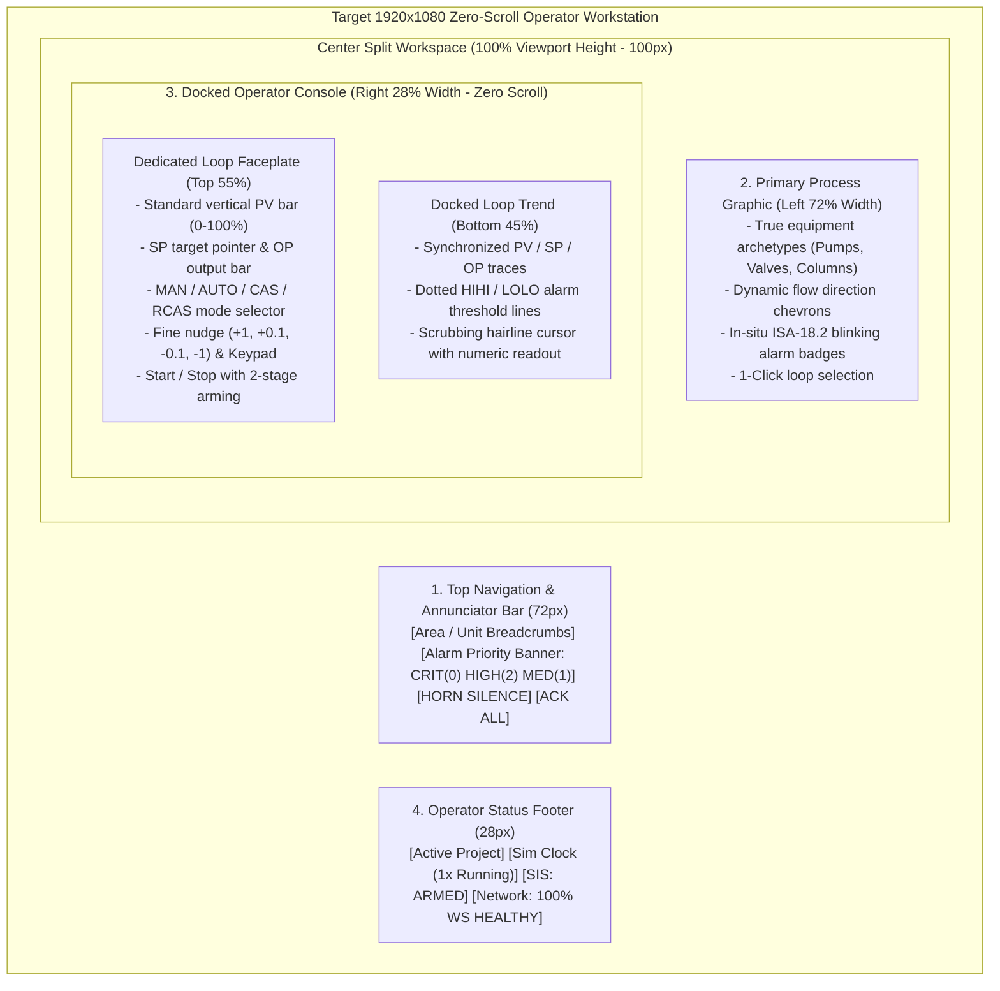

### Key Functional Invariants:
1. **Zero-Scroll Guarantee**: The primary graphic, faceplate, and trend must be visible simultaneously without vertical scrolling.
2. **Contextual Binding**: Selecting any instrument or equipment on the flowsheet instantly populates the docked faceplate and trend with that tag's data.
3. **Strict Containment**: No raw tag memory editing, simulation clock pausing, or schematic wiring tools may appear in the Operations workspace.

---

## 23. Required Changes (Implementation Blueprint)

### A. Process Graphic Fixes (`nebu-process-view.ts`)
- Replace substring matching on `defId` with proper archetype resolution:
  ```typescript
  // Inspect category, name, or definition symbol
  const archetype = eq.category?.toLowerCase() || eq.name?.toLowerCase() || "";
  ```
- Map archetypes correctly to `"pump" | "compressor" | "valve" | "column" | "exchanger" | "tank" | "vessel"`.
- Emit exact archetype kind in `select-equipment` event.
- Render ISA-18.2 priority badges (`▲ HI`, `▼ LO`) on instrument bubbles when tagged alarm state is active.

### B. Layout Restructuring (`nebu-dcs-shell.ts` & `main.css`)
- Remove `grid-template-columns: 1fr 380px;` from `.app-main` or provide a full-width container class for the DCS workspace (`grid-template-columns: 1fr;`).
- Restructure `nebu-dcs-shell.ts` template into a CSS grid:
  - Header: Top Annunciator & Breadcrumbs (`height: 72px`).
  - Left Pane: Primary Process Graphic (`flex: 1`, min-width: 1100px).
  - Right Pane: Docked Console containing Faceplate (top) and Trend (bottom) (`width: 420px`).
- Remove `<nebu-tag-table>` from the Operations sidebar.

### C. Faceplate Upgrades (`nebu-faceplate.ts`)
- Ensure pump, valve, and compressor profiles are correctly dispatched based on resolved archetype.
- Remove hardcoded static strings (`12.4 bar`, etc.); replace with reactive bindings to tag values with explicit `N/A` or `--` when disconnected.
- Add vertical PV bar gauge with SP target pointer and OP bar.
- Add two-stage confirm prompt for critical equipment commands (START, TRIP, RESET).

### D. Trend Enhancements (`nebu-trend.ts`)
- Support multi-trace normalized rendering for PV, SP, and OP.
- Render dashed horizontal lines for alarm limits ($HIHI, HI, LO, LOLO$).
- Add time-scrubbing crosshair on hover.

### E. Runtime Communication Optimization
- Eliminate `setInterval(..., 1000)` polling loop in `nebu-dcs-shell.ts`.
- Route alarm summaries, first-out events, and diagnostic counters exclusively through WebSocket push deltas.

---

## 24. Test Matrix

| Test ID | Subsystem | Test Case Description | Expected Result | Pass Criteria |
| :--- | :--- | :--- | :--- | :--- |
| **TM-OPS-01** | Process Graphic | Render plant with pumps, valves, and vessels | Pumps render with pump symbol; valves with valve symbol | Zero fallback to generic vessel for known archetypes |
| **TM-OPS-02** | Faceplate Binding | Click pump P-101A on flowsheet | Faceplate opens with START, STOP, and TRIP buttons | Pump profile active; generic profile NOT invoked |
| **TM-OPS-03** | Layout / 1080p | Render at 1920x1080 viewport | Flowsheet, faceplate, and trend fully visible without scroll | Zero vertical scrollbar on primary container; 0px dead space |
| **TM-OPS-04** | Mode Switching | Toggle controller mode MAN -> AUTO | Controller mode updates in Rust core; UI displays confirmation | State transitions within 100ms via WebSocket |
| **TM-OPS-05** | Alarm Navigation | Click active HIGH alarm in annunciator bar | Flowsheet pans/centers to source tag; tag bubble pulses | Source identified without manual search |
| **TM-OPS-06** | Trend Limit Overlay| Trend tag with active alarm thresholds | Canvas displays horizontal dashed red/amber threshold lines | Lines match project database alarm setpoints |
| **TM-OPS-07** | Containment / RBAC | Log in as Operator role | Sidebar contains no raw tag editor; sim clock cannot be paused | No direct tag memory write inputs available |
| **TM-OPS-08** | Network Efficiency | Monitor browser network tab for 60 seconds | Zero repetitive 1 Hz GET requests to `/api/alarms/summary` | 100% of telemetry handled over WebSocket |

---

## 25. Browser Screenshot Evidence

The following 17 high-resolution ($1920 \times 1080$) forensic screenshots were captured against the live NebuDCS production environment (`http://127.0.0.1:8088`, project `proj-01M1VZ8254MTXSN27GYB4XYEBN`) to substantiate all findings in this audit:

````carousel

<!-- slide -->

<!-- slide -->

<!-- slide -->

<!-- slide -->

<!-- slide -->

<!-- slide -->

<!-- slide -->

<!-- slide -->

<!-- slide -->

<!-- slide -->

<!-- slide -->

<!-- slide -->

<!-- slide -->

<!-- slide -->

<!-- slide -->

<!-- slide -->

````

### Detailed Screenshot Inventory:
1. **[Operations Startup](file:///root/NebuDCS/docs/reports/screenshots/operations/operations_01_startup.png)**: Shows initial workstation load with 380px black dead space on the right and stacked flowsheet.
2. **[Area Navigation](file:///root/NebuDCS/docs/reports/screenshots/operations/operations_02_area_navigation.png)**: Documents the static `<select id="selCrumbArea">` dropdown lacking change handlers.
3. **[Unit Process Graphic](file:///root/NebuDCS/docs/reports/screenshots/operations/operations_03_unit_process_graphic.png)**: Evidence of all equipment rendering as identical vertical gray cylinders with 0.4% fill.
4. **[Equipment Selected](file:///root/NebuDCS/docs/reports/screenshots/operations/operations_04_equipment_selected.png)**: Highlights selected equipment bounding box and generic tag bindings.
5. **[Faceplate Open](file:///root/NebuDCS/docs/reports/screenshots/operations/operations_05_faceplate_open.png)**: Demonstrates faceplate opening below the flowsheet in the scroll stack.
6. **[Controller Mode](file:///root/NebuDCS/docs/reports/screenshots/operations/operations_06_controller_mode.png)**: Displays mode options limited to AUTO/MANUAL/CASCADE without RCAS.
7. **[Equipment Command](file:///root/NebuDCS/docs/reports/screenshots/operations/operations_07_equipment_command.png)**: Shows generic property sheet rendered when clicking equipment, lacking pump start/stop buttons.
8. **[Active Alarm](file:///root/NebuDCS/docs/reports/screenshots/operations/operations_08_active_alarm.png)**: Shows amber alarm ribbon displaying 2 active alarms.
9. **[Alarm Acknowledged](file:///root/NebuDCS/docs/reports/screenshots/operations/operations_09_alarm_acknowledged.png)**: Shows transition of alarm row following acknowledge trigger.
10. **[Alarm Detail](file:///root/NebuDCS/docs/reports/screenshots/operations/operations_10_alarm_detail.png)**: Inline alarm detail expansion covering annunciator space.
11. **[Trend](file:///root/NebuDCS/docs/reports/screenshots/operations/operations_11_trend.png)**: Documents single-axis canvas trend at bottom of the page.
12. **[SIS Interlock State](file:///root/NebuDCS/docs/reports/screenshots/operations/operations_12_sis_interlock_state.png)**: Documents the emergency shutdown and interlock panel at the bottom of the scroll stack.
13. **[Command Palette](file:///root/NebuDCS/docs/reports/screenshots/operations/operations_13_command_palette.png)**: Shows modal search overlay with generic commands.
14. **[Operator Status Bar](file:///root/NebuDCS/docs/reports/screenshots/operations/operations_14_operator_status_bar.png)**: Displays simulation clock and diagnostic counters in footer.
15. **[Engineer Role Comparison](file:///root/NebuDCS/docs/reports/screenshots/operations/operations_15_engineer_role_comparison.png)**: Demonstrates identical sidebar tag table exposed to both engineer and operator.
16. **[Trainee Role Comparison](file:///root/NebuDCS/docs/reports/screenshots/operations/operations_16_trainee_role_comparison.png)**: Shows trainee view with simulation controls still visible.
17. **[Workstation 1920x1080](file:///root/NebuDCS/docs/reports/screenshots/operations/operations_17_workstation_1920x1080.png)**: Full resolution 1080p workstation capture proving the 380px black dead margin on the right edge.

---

## 26. Risks & Mitigation

| Risk Category | Description | Severity | Mitigation Strategy |
| :--- | :--- | :--- | :--- |
| **Operational Confusion** | Operators cannot locate pump controls during an abnormal event due to archetype failure. | **HIGH** | Immediate fix of archetype resolution logic in `nebu-process-view.ts` during Stage 14 implementation pass. |
| **Accidental Tag Forcing** | Operators editing raw memory tags in sidebar can inadvertently trip the plant or destabilize simulation. | **CRITICAL**| Remove `<nebu-tag-table>` entirely from Operations workspace; restrict to Engineering workspace. |
| **Screen Fragmentation** | Introducing responsive sidebars might break layout on smaller laptop screens. | **MEDIUM** | Enforce minimum supported resolution of 1366x768 with collapsible panels; optimize for standard 1920x1080. |
| **WebSocket Saturation** | Removing REST polling and sending all high-speed alarms via WS could increase message volume. | **LOW** | NebuDCS Rust WebSocket engine uses batched deltas; alarm updates occur on state transition only, consuming negligible bandwidth. |

---

## 27. Acceptance Criteria for Future Implementation

To achieve full operational parity with industrial DCS operator stations without violating Stage 14 boundaries:
- [ ] **AC-01 (Archetype Resolution)**: All pumps, valves, compressors, and heat exchangers in the project render with distinct, identifiable industrial symbols instead of generic cylinder vessels.
- [ ] **AC-02 (Dedicated Faceplates)**: Clicking any pump or valve opens its dedicated control profile with working START/STOP or Stroke controls.
- [ ] **AC-03 (Zero Dead Space)**: The entire 1920x1080 screen width is utilized; the 380px black column in `main.css` is completely eliminated in the Operations workspace.
- [ ] **AC-04 (Zero-Scroll Docking)**: Process Graphic, Faceplate, and Trend are co-located in a docked layout requiring zero vertical scrolling during normal monitoring and control.
- [ ] **AC-05 (Alarm In-Situ Indication)**: Active alarms display blinking ISA-18.2 priority badges directly on the instrument bubbles in the process graphic.
- [ ] **AC-06 (Engineering Containment)**: Raw tag memory editing table (`nebu-tag-table`) is completely removed from the Operations workspace.
- [ ] **AC-07 (Authoritative Telemetry)**: All faceplate metrics are dynamically bound to live tag values; all hardcoded fallback numbers are removed.
- [ ] **AC-08 (Zero Redundant Polling)**: The 1 Hz `setInterval` REST polling loop is removed in favor of purely event-driven WebSocket updates.
