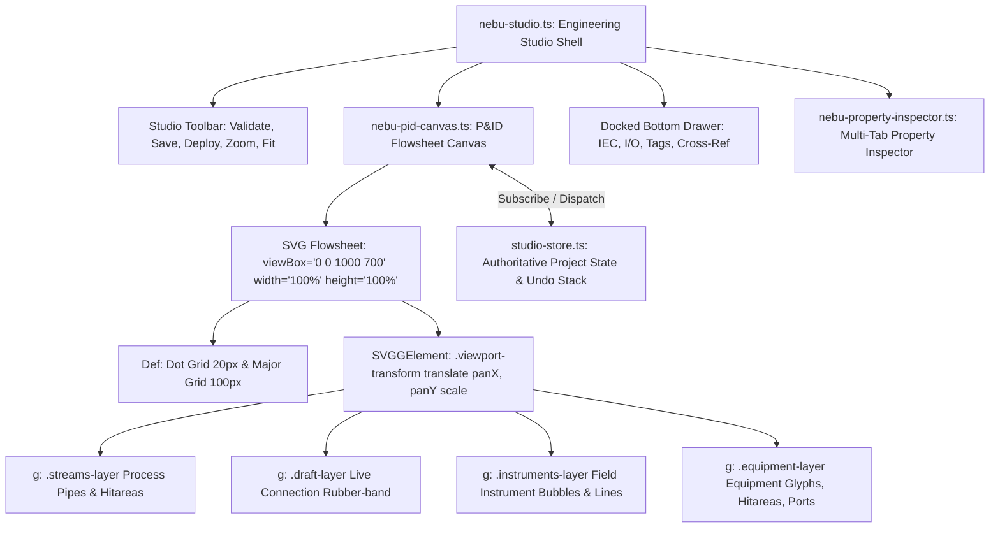
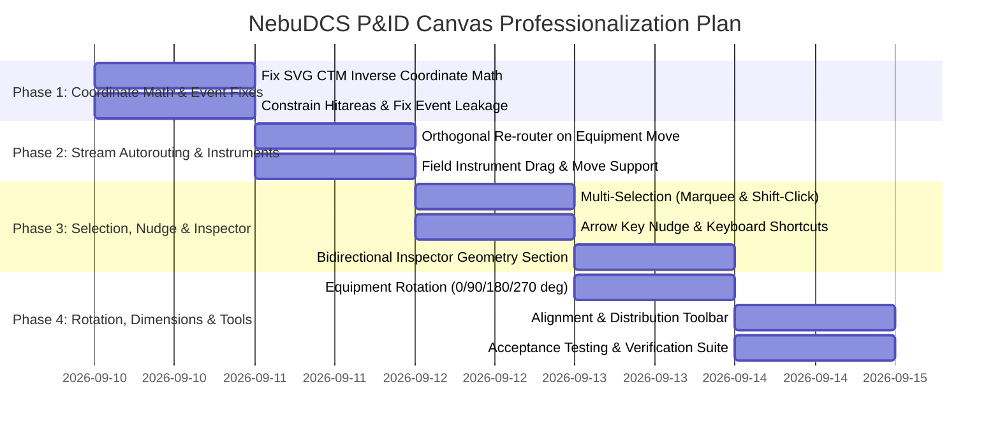

# NebuDCS Stage 14: Engineering Studio P&ID Canvas & Equipment Manipulation Forensic Audit

**Document**: `stage_14_pid_canvas_equipment_interaction_audit.md`  
**Author**: Principal Industrial UI/UX Architect, DCS/HMI Engineer, P&ID Editor Architect & Senior Rust/TypeScript Engineer  
**Date**: 2026-09-09  
**Status**: READ-ONLY FORENSIC AUDIT COMPLETE  
**Scope**: Engineering Studio (`nebu-studio.ts`), P&ID Flowsheet Canvas (`nebu-pid-canvas.ts`), Property Inspector (`nebu-property-inspector.ts`), Equipment Palette (`nebu-equipment-palette.ts`), Studio Store (`studio-store.ts`), and Backend Persistence (`apps/nebudcs-server`, `crates/nebudcs-protocol`)  
**Baseline**: Phase 0–16 VERIFIED | Stages 1–13 VERIFIED | Stage 14 Final Baseline (READ-ONLY AUDIT — NO CODE/SCHEMA MUTATIONS)

---

## 1. Executive Summary

This forensic audit investigates why users currently cannot properly manipulate plant equipment on the NebuDCS Engineering Studio canvas and establishes a precise, industrial-grade implementation specification for transforming the flowsheet canvas into a professional CAD/P&ID engineering editor.

### Key Audit Finding
The NebuDCS flowsheet canvas was architected with a solid foundation of domain template resolution, orthogonal pipe drafting, and command-based undo/redo. However, **equipment manipulation in the current implementation fails or feels broken due to six interrelated root causes**:
1. **Screen Pixel vs. SVG ViewBox Coordinate Mismatch**: The drag handler calculates displacement using raw screen pixels divided by zoom scale (`(e.clientX - startX) / scale`), completely ignoring the SVG `viewBox` scaling factor (`viewBoxWidth / clientWidth`). At non-1:1 aspect ratios or standard monitor resolutions (1080p, 1440p, 4K), objects jump, detach from the mouse cursor, or exhibit erratic movement.
2. **Invisible Hitbox Overlaps & Event Swallowing**: Equipment nodes feature an oversized transparent hit area (`<rect width="76" height="116">`). In realistic or tightly spaced unit configurations (e.g. the default smoke drill where `K-102` at (120, 290) sits directly over `PUMP-A1` at (100, 250)), the latter node in DOM order completely covers and swallows all mouse down/click events of the underlying equipment.
3. **Manhattan Stream Geometry Destruction on Movement**: When equipment moves, connected streams only update `points[0]` and `points[N-1]`. Intermediate waypoints remain frozen at obsolete coordinates, causing orthogonal pipes to degrade into non-standard diagonal lines (`M 130 250 L 430 150`) or jagged kinks, while leaving streams un-rerouted in the project data store.
4. **Complete SVG DOM Demolition on Every State Mutation**: `nebu-pid-canvas.ts` re-renders by executing `this.innerHTML = ...` on every single store notification (including simple selection clicks). This destroys SVG DOM element references, drops browser focus, breaks native drag continuations, and leaks event listeners onto `window`.
5. **Zero Manipulation for Non-Equipment Entities**: Field instruments (`<g class="instrument-node">`) and signal lines only possess click listeners. `studioStore` lacks a `moveInstrument` command, preventing users from rearranging instrument bubbles.
6. **Absence of Core CAD Capabilities**: The system currently lacks equipment resize handles, custom visual dimensions, rotation/orientation (valves and pumps cannot be rotated for vertical pipes), multi-selection (marquee rectangle), alignment/distribution tools, keyboard arrow nudging, and bidirectional inspector coordinate editing.

Importantly, **the backend persistence pipeline itself is fully functional**: `position: { x, y }` coordinates successfully survive `saveProject` $\to$ SQLite disk persistence $\to$ page reload. The root causes reside entirely in the interaction layer, coordinate transforms, event handling, and layout synchronization.

---

## 2. Current Canvas Architecture

The Engineering Studio flowsheet editor is organized in a hierarchical component tree:



### File & Code Inventory
- **[`web/src/components/nebu-pid-canvas.ts`](file:///root/NebuDCS/web/src/components/nebu-pid-canvas.ts)** (1,140 lines): Web Component handling SVG rendering, viewport transform, port stub layout, orthogonal stream routing, and mouse/pointer listeners.
- **[`web/src/state/studio-store.ts`](file:///root/NebuDCS/web/src/state/studio-store.ts)** (661 lines): In-memory project model, selection state (`SelectedEntity | null`), command history (`undoStack`, `redoStack`), and mutators (`addEquipment`, `moveEquipment`, `deleteEquipment`, `addStream`, `deleteStream`).
- **[`web/src/components/nebu-property-inspector.ts`](file:///root/NebuDCS/web/src/components/nebu-property-inspector.ts)** (680 lines): Capability-driven inspector (`general`, `process`, `motor`, `limits`, `control`, `historian`).
- **[`web/src/components/nebu-equipment-palette.ts`](file:///root/NebuDCS/web/src/components/nebu-equipment-palette.ts)**: HTML5 drag-and-drop source for equipment templates.
- **[`crates/nebudcs-protocol/src/dto.rs`](file:///root/NebuDCS/crates/nebudcs-protocol/src/dto.rs)**: Rust DTO definitions (`StudioEquipmentDto`, `Position2dDto`, `StudioStreamDto`).
- **[`apps/nebudcs-server/src/project_manager.rs`](file:///root/NebuDCS/apps/nebudcs-server/src/project_manager.rs)**: Disk persistence and validation engine.

---

## 3. Existing Interaction Inventory

| Feature | Status | Implementation Details & Behavioral Defect |
| :--- | :---: | :--- |
| **Select Equipment** | **PARTIAL** | Click on `.eq-node` selects entity in `studioStore`. **Defect**: Swallowed by overlapping hitboxes; triggers full `innerHTML` re-render. |
| **Drag Equipment** | **BROKEN** | `mousedown` initiates `dragState`. **Defect**: Screen pixel vs viewBox mismatch causes cursor detachment; window listeners leak; streams do not update during drag. |
| **Move Freely (Pan)** | **PASS** | `Middle Click` or `Space + Left Drag` pans viewport smoothly across `panX` and `panY`. |
| **Zoom In / Out** | **PASS** | Mouse wheel zooms around cursor; toolbar `+`/`-` and keyboard `+`/`-` zoom smoothly between 0.3x and 2.5x. |
| **Fit-to-View** | **PARTIAL** | Centers equipment bounding box. **Defect**: Ignores instruments and stream routes; resets zoom without animation. |
| **Zoom to Selection** | **MISSING** | No method or shortcut exists to center and frame selected equipment. |
| **Multi-Selection** | **MISSING** | `studioStore.selected` only stores a single entity (`{ type, id }`). No marquee box selection or Shift-click. |
| **Move Multiple Items** | **MISSING** | Only the single `equipmentId` in `dragState` can be translated. |
| **Equipment Resize** | **MISSING** | Symbols use fixed hardcoded SVG dimensions; no resize handles; no width/height fields in schema. |
| **Rotation / Orientation**| **MISSING** | No rotation field or transform. Valves, pumps, and exchangers cannot be rotated for vertical pipe runs. |
| **Alignment & Distribution**| **MISSING** | No align left/right/top/bottom or distribute horizontally/vertically tools exist. |
| **Grid Snapping** | **HARDCODED** | Hardcoded to `Math.round(val / 10) * 10`. No toggle to disable snapping; no configurable grid sizes. |
| **Connection Anchoring** | **PASS** | Port layouts compute relative pin positions (`relX`, `relY`) correctly per equipment type. |
| **Stream Routing Preservation**| **BROKEN** | Moving equipment updates only endpoint 0 and N-1; intermediate waypoints freeze, creating diagonal pipes. |
| **Instrument Movement** | **MISSING** | Instruments only have `click` listeners. No `mousedown` handler; no `moveInstrument` in store. |
| **Label Positioning** | **FIXED** | Equipment tag labels are locked at `(0, 68)` below center; stream labels locked at midpoint. No offset editing. |
| **Overlap / Collision Handling**| **MISSING** | Nodes spawn on top of each other with zero separation warnings or automatic layout spacing. |
| **Undo / Redo** | **PARTIAL** | `Ctrl+Z` / `Ctrl+Y` undoes `moveEquipment`. **Defect**: Does not undo or restore stream routing geometry. |
| **Delete / Duplicate** | **PARTIAL** | `Delete` key deletes selected entity. Duplicate (`Ctrl+D`) and Copy/Paste are completely missing. |
| **Keyboard Nudge** | **MISSING** | Arrow keys do nothing on selected equipment. |
| **Inspector Coordinates** | **READ-ONLY** | Coordinates are rendered as static text `<span class="mono text-xs text-dim">`. Numeric inputs missing. |
| **Persistence (Save/Reload)**| **PASS** | `position: { x, y }` correctly saves to SQLite disk store and survives full page reloads. |

---

## 4. Deep Forensic Root-Cause Analysis

### 4.1 Root Cause 1: Screen Pixel vs. SVG ViewBox Coordinate Mismatch
**Location**: `web/src/components/nebu-pid-canvas.ts`, lines 960–970 and 1025–1035.
```typescript
// On Mouse Move (line 961)
const dx = (e.clientX - this.dragState.startX) / this.scale;
const dy = (e.clientY - this.dragState.startY) / this.scale;
const newX = Math.round((this.dragState.origX + dx) / 10) * 10;
const newY = Math.round((this.dragState.origY + dy) / 10) * 10;
```
**Mechanism of Failure**:
- `e.clientX` is measured in CSS screen pixels relative to the browser viewport.
- The canvas SVG element is declared as: `<svg class="pid-svg" width="100%" height="100%" viewBox="0 0 1000 700">`.
- On a 1920×1080 display with a studio canvas width of 1440px, the SVG CTM (Current Transformation Matrix) scales 1 SVG coordinate unit to `1440 / 1000 = 1.44` screen pixels (or `1 screen pixel = 0.694 SVG units`).
- When dragging 100 screen pixels, `dx` evaluates to `100 / 1.0 = 100` SVG units, instead of the true `69.4` units.
- While `getSvgCoordinates(e)` (lines 818–828) correctly uses `svg.getScreenCTM().inverse()`, the drag handler ignored this helper and computed raw screen differences.
- **Effect**: The object accelerates ahead of or lags behind the mouse pointer. At non-standard aspect ratios or high zoom factors, dragging becomes completely uncoordinated.

### 4.2 Root Cause 2: Invisible Hitbox Overlap & Event Interception
**Location**: `web/src/components/nebu-pid-canvas.ts`, line 596.
```typescript
<rect x="-38" y="-58" width="76" height="116" fill="transparent" class="eq-hitarea" pointer-events="all" />
```
**Mechanism of Failure**:
- Each equipment node renders a transparent rectangle measuring 76px wide by 116px tall to capture pointer events.
- In the default project layout generated by `apps/nebudcs-server/src/project_manager.rs`:
  - `PUMP-A1` is at `(100, 250)` $\implies$ hit area extends `[X: 62..138, Y: 192..308]`.
  - `K-102` is at `(120, 290)` $\implies$ hit area extends `[X: 82..158, Y: 232..348]`.
  - Overlap zone: `X: 82..138, Y: 232..308` (56px × 76px).
- In SVG rendering, elements later in DOM tree order paint on top and receive pointer events first. Because `K-102` appears later in the equipment list than `PUMP-A1`, its transparent hit area covers `PUMP-A1`.
- Clicking on `PUMP-A1` triggers `mousedown` on `K-102`.
- **Effect**: Users report "equipment cannot be selected or moved" because clicking on what looks like a pump actually grabs an overlapping invisible rectangle from another unit.

### 4.3 Root Cause 3: Manhattan Stream Geometry Destruction on Movement
**Location**: `web/src/components/nebu-pid-canvas.ts`, lines 619–625 and `studio-store.ts`, lines 213–239.
```typescript
let points = stream.route_points;
if (!points || points.length < 2) {
  points = this.computeOrthogonalWaypoints(p1, p2);
} else {
  points[0] = { x: p1.x, y: p1.y };
  points[points.length - 1] = { x: p2.x, y: p2.y };
}
```
**Mechanism of Failure**:
- When equipment moves from `(300, 250)` to `(400, 150)`, `p1` or `p2` changes.
- If `route_points` has 2 points (straight horizontal connection `M 130 250 L 330 250`), updating `points[0]` and `points[1]` results in `M 130 250 L 430 150` — a **slanted diagonal pipe**, violating ISA-5.1 drafting standards.
- If `route_points` has 4 waypoints, intermediate corners remain pinned at the old coordinates while endpoints move, creating deformed shapes.
- Connected streams are not updated dynamically during `onMouseMove`.
- On `mouseup`, `studioStore.moveEquipment` only records the new equipment position; it never recomputes or writes updated stream waypoints back to the project DTO.
- **Effect**: Moving any connected unit ruins the schematic topology, creating diagonal lines that save to the project.

### 4.4 Root Cause 4: SVG DOM Demolition & Listener Leakage
**Location**: `web/src/components/nebu-pid-canvas.ts`, lines 659–811 and 1037–1040.
```typescript
// Inside render()
this.innerHTML = `... <svg class="pid-svg"> ... </svg> ...`;
this.bindCanvasEvents();

// Inside bindCanvasEvents()
const onMouseMove = (e: MouseEvent) => { ... };
const onMouseUp = (e: MouseEvent) => { ... };
window.removeEventListener("mousemove", onMouseMove); // NO-OP: onMouseMove is a new function instance!
window.addEventListener("mousemove", onMouseMove);
```
**Mechanism of Failure**:
- Any state change (e.g. clicking an entity to select it) invokes `this.render()`, which replaces `this.innerHTML`.
- This wipes all SVG elements, causing DOM churn and dropping active pointer tracking.
- `onMouseMove` and `onMouseUp` are local functions declared inside the scope of `bindCanvasEvents()`. Calling `window.removeEventListener("mousemove", onMouseMove)` fails to remove previously registered handlers because the reference is newly created on each render.
- After 10 user interactions, 10 duplicate `mousemove` and `mouseup` listeners are executing concurrently on every mouse movement.

### 4.5 Root Cause 5: Complete Omission of Non-Equipment Entity Manipulation
**Location**: `web/src/components/nebu-pid-canvas.ts`, lines 1053–1062.
- Instrument elements (`<g class="instrument-node">`) only bind a `click` listener for selection.
- No `mousedown` handler exists for instruments.
- `StudioStore` contains `moveEquipment` but has no `moveInstrument` method.
- Users cannot rearrange field instruments or adjust bubble positions.

---

## 5. Detailed Domain Findings

### 5.1 Zoom & Pan Findings
- **Zoom Range**: Clamped to `[0.3, 2.5]`.
- **Zoom Center**: Mouse wheel zooms around cursor position using bounding client rect pivot calculations, which works smoothly.
- **Pan Navigation**: Middle-click or `Space + Left Drag` operates reliably.
- **Defects**:
  - `fitToView()` only checks `proj.equipment` positions, ignoring instruments and stream waypoints. If an instrument is located outside the equipment envelope, it is clipped.
  - Viewport zoom and pan offsets (`scale`, `panX`, `panY`) are held only in component memory. Navigating to another tab and back resets the view to default.
  - No "Zoom to Selection" capability exists.

### 5.2 Resize Findings
- **Data Model**: `StudioEquipmentDto` contains:
  ```typescript
  export interface StudioEquipmentDto {
    id: string;
    definition_id: string;
    definition_version: string;
    name: string;
    parameters: Record<string, number>;
    position?: Position2dDto;
  }
  ```
  Neither the TypeScript DTO nor the Rust backend struct (`crates/nebudcs-protocol/src/dto.rs`, line 362) contains `width`, `height`, or `dimensions`.
- **Glyph Rendering**: Every symbol is drawn with hardcoded numbers (e.g., Pump circle `r="28"`, Tank rect `width="52" height="74"`, Vessel rect `width="48" height="90"`).
- **Inspector**: No fields for width or height exist in `nebu-property-inspector.ts`.
- **Distinction Required**: Physical engineering dimensions (e.g., vessel volume $15\,\text{m}^3$, tank height $12\,\text{m}$) must remain distinct from schematic visual dimensions (`display_width`, `display_height`).

### 5.3 Selection & Multi-Selection Findings
- **Current State**: `studioStore.selected` is a single object:
  ```typescript
  export interface SelectedEntity {
    type: SelectableType;
    id: string;
  }
  ```
- **Limitations**:
  - No support for multiple selected entities.
  - No marquee / rubber-band selection rectangle when dragging on empty canvas background.
  - `Shift + Click` and `Ctrl + Click` to toggle selection do not exist.
  - Group movement is impossible.

### 5.4 Rotation & Orientation Findings
- Neither the schema nor the renderer supports orientation.
- In process plants, control valves, check valves, relief valves, and heat exchangers frequently mount vertically or horizontally.
- Without a `rotation` field (`0`, `90`, `180`, `270` degrees), all valves are locked horizontally, preventing proper modeling of vertical pipe drops into vessel bottoms or column overheads.

### 5.5 Alignment & Distribution Findings
- No alignment utilities exist (Align Left, Center, Right, Top, Middle, Bottom).
- No distribution utilities exist (Distribute Horizontally, Distribute Vertically).
- In industrial P&ID authoring, aligning pump suction/discharge nozzles and vertical vessel baselines is a standard productivity requirement.

### 5.6 Grid Snapping Findings
- Snapping is hardcoded to a 10px grid: `Math.round(val / 10) * 10`.
- The background renders a 20px dot grid and 100px major grid.
- There is no UI switch to toggle snapping off for fine adjustments, nor can the grid interval be adjusted.

### 5.7 Property Inspector Integration Findings
- In `nebu-property-inspector.ts` (line 209):
  ```html
  <label>Coordinates</label>
  <span class="mono text-xs text-dim">X: ${eq.position?.x ?? 0}, Y: ${eq.position?.y ?? 0}</span>
  ```
- Coordinates are static text. Engineers cannot type `X: 450, Y: 300` to align objects numerically.
- Inspector has no layout section for X, Y, Width, Height, Rotation, or Z-order.
- Changes made on the canvas update the inspector only because the store notifies and re-renders the inspector.

### 5.8 Persistence & Deployment Lifecycle
- **Save Verification**: Moving an isolated equipment, clicking `Save`, and reloading the browser proved that `equipment[i].position` persists cleanly to the backend disk store.
- **Deployment Behavior**: Clicking `[🚀 Deploy to Runtime]` invokes `apiClient.loadProjectSim(id)`. The simulation engine compiles process topology (ports, streams, parameters) into the physics solver and tag store, completely ignoring coordinates.
- **Model vs View Integrity**: Visual layout coordinates do NOT affect numerical physics simulation, which satisfies the architectural requirement of separating Process Model from Layout Model.

### 5.9 Undo / Redo Findings
- `StudioStore` implements a command pattern (`StudioCommand`).
- `moveEquipment` pushes an atomic command on `mouseup`. `Ctrl+Z` properly restores the prior position.
- **Flaw**: Because connected stream paths are not updated as part of the command transaction, undoing an equipment move leaves stream route points out of sync.

---

## 6. Industrial Interaction Benchmark

Comparing NebuDCS with leading industrial DCS/CAD environments:

| Feature / Principle | Siemens TIA Portal / Rockwell Studio 5000 | Honeywell Experion / AVEVA Diagrams | Current NebuDCS Stage 14 | Target NebuDCS Architecture |
| :--- | :--- | :--- | :--- | :--- |
| **Object Selection** | Click, Marquee Box, Shift-Add, Ctrl-Toggle | Click, Window Select, Crossing Select | Single-click only, broken by overlapping hitboxes | Primary click, Shift/Ctrl multi-select, Marquee box drag |
| **Object Dragging** | Sub-pixel precision with snap guides and coordinate tooltips | Smart ortho guides, collision warnings | Broken screen/viewbox math, jerky jump | World-space CTM matrix transform, live stream rubber-band |
| **Stream / Wire Routing**| Auto-Manhattan with corner push and obstacle avoidance | Orthogonal autoroute with manual waypoint handles | Endpoints stretch; intermediate points freeze | Real-time orthogonal autorouting on node move + manual handles |
| **Rotation** | 90° incremental rotation via Space or toolbar | 90° / 180° rotation + flip horizontal/vertical | None (fixed 0°) | 90° stepping (`0°`, `90°`, `180°`, `270°`) with port repositioning |
| **Resize** | 8-point bounding handles on scalable blocks | Parametric aspect-ratio locked sizing | None (hardcoded SVGs) | Visual bounding handles + Inspector width/height overrides |
| **Inspector Coordinates**| Bidirectional numeric fields (X, Y, W, H) | Floating property bar + dock inspector | Read-only static text | Live editable numeric spinboxes with Enter/Tab commit |
| **Alignment** | Align toolbar (edges, centers, distribute) | Auto-distribute, grid snap override | None | Alignment bar: Left, Center, Right, Top, Middle, Bottom |
| **DOM / Rendering** | Retained canvas / WebGL / virtualized nodes | Optimized scene graph | `innerHTML` full destroy & replace | Targeted transform updates on drag; retained SVG node graph |

---

## 7. P0 / P1 / P2 / P3 Issue Classification

### Critical Defects (P0) — Blocks Basic Equipment Manipulation
- **P0-1: SVG ViewBox Coordinate Desynchronization**: Fix drag calculations to use `getSvgCoordinates(e)` via `svg.getScreenCTM().inverse()`, preventing cursor detachment.
- **P0-2: Overlapping Hitbox Event Swallowing**: Constrain `.eq-hitarea` to the actual equipment glyph bounds and ensure accurate z-indexing so underlying equipment can be clicked and selected.
- **P0-3: Manhattan Stream Geometry Destruction**: Implement automatic orthogonal route regeneration when connected equipment moves, preventing diagonal pipes.
- **P0-4: Event Listener Accumulation**: Migrate `window.addEventListener("mousemove")` and `mouseup` to persistent component lifecycle handlers, eliminating listener leakage.

### High-Priority Defects (P1) — Essential Engineering Productivity
- **P1-1: Field Instrument Drag & Move**: Add pointer event handling for `.instrument-node` and implement `studioStore.moveInstrument()`.
- **P1-2: Bidirectional Inspector Coordinates**: Replace read-only coordinate text with editable numeric inputs for `X` and `Y`.
- **P1-3: Equipment Rotation (`0°`, `90°`, `180°`, `270°`)**: Add orientation support so valves, pumps, and exchangers can be mounted vertically.
- **P1-4: Multi-Selection & Group Dragging**: Support `Shift + Click`, `Ctrl + Click`, marquee box selection, and moving multiple selected units.
- **P1-5: Keyboard Nudging**: Implement Arrow keys (10px nudge) and `Shift + Arrow` (50px nudge).

### Medium-Priority Defects (P2) — Industrial Refinement & Ergonomics
- **P2-1: Configurable Equipment Dimensions & Resize Handles**: Add `display_width` and `display_height` to equipment DTO and provide corner drag handles.
- **P2-2: Snap-to-Grid Toggle & Density Selector**: Provide toolbar toggles for Grid Snap (`On`/`Off`) and spacing (`5px`, `10px`, `20px`).
- **P2-3: Alignment & Distribution Utilities**: Add toolbar buttons for Align (Left, Center, Right, Top, Middle, Bottom) and Distribute.
- **P2-4: Duplicate & Copy/Paste**: Implement `Ctrl + D` (duplicate entity with +20px offset) and `Ctrl + C` / `Ctrl + V`.
- **P2-5: Viewport State Persistence**: Retain `panX`, `panY`, and `scale` across tab and view switches.

### Low-Priority Enhancements (P3) — Polish & Documentation
- **P3-1: Smart Alignment Guides**: Temporary crosshair guidelines when dragging near alignment with adjacent ports or nodes.
- **P3-2: Zoom to Selection**: Keyboard shortcut `F` to frame selected equipment.

---

## 8. Recommended Target Interaction Model

### 8.1 Pointer Interaction Paradigm
```
+---------------------------------------------------------------------------------------+
| POINTER ACTION       | TARGET                    | BEHAVIOR                           |
+----------------------+---------------------------+------------------------------------+
| Left Click           | Equipment / Instrument    | Select entity (clear others)       |
| Shift / Ctrl + Click | Equipment / Instrument    | Toggle entity in multi-selection   |
| Left Drag            | Selected Entity           | Move all selected entities         |
| Left Drag            | Empty Canvas Background   | Marquee selection rectangle        |
| Space + Left Drag    | Any                       | Pan viewport                       |
| Middle Click Drag    | Any                       | Pan viewport                       |
| Double Click         | Equipment                 | Focus Inspector "General" tab      |
| Mouse Wheel          | Canvas                    | Zoom in/out anchored at cursor     |
| Corner Handle Drag   | Selected Equipment Corner | Resize width / height              |
+---------------------------------------------------------------------------------------+
```

### 8.2 Keyboard Shortcuts Map
```
+---------------------------------------------------------------------------------------+
| KEYSTROKE            | SCOPE                     | ACTION                             |
+----------------------+---------------------------+------------------------------------+
| Delete / Backspace   | Active Selection          | Delete selected entities & streams |
| Arrow Keys           | Active Selection          | Nudge 1 grid unit (10px)           |
| Shift + Arrow Keys   | Active Selection          | Nudge large step (50px)            |
| Ctrl + A             | Canvas Focus              | Select all equipment & instruments |
| Ctrl + D             | Active Selection          | Duplicate with offset              |
| Ctrl + Z             | Studio Global             | Undo last canvas action            |
| Ctrl + Y / Shift+Z   | Studio Global             | Redo canvas action                 |
| Escape               | Canvas Global             | Cancel draft / Deselect all        |
| + / =                | Canvas Global             | Zoom in 20%                        |
| -                    | Canvas Global             | Zoom out 20%                       |
| 0                    | Canvas Global             | Fit all entities to view           |
| R                    | Active Selection          | Rotate 90 degrees clockwise        |
+---------------------------------------------------------------------------------------+
```

---

## 9. Required Data & Schema Changes

### 9.1 Protocol DTOs (`crates/nebudcs-protocol/src/dto.rs` & `web/src/protocol/types.ts`)
To preserve backward compatibility, all new fields are optional (`#[serde(default)]` in Rust, `?` in TypeScript):

```rust
// crates/nebudcs-protocol/src/dto.rs
#[derive(Debug, Clone, PartialEq, Serialize, Deserialize)]
pub struct StudioEquipmentDto {
    pub id: String,
    pub definition_id: String,
    pub definition_version: String,
    pub name: String,
    #[serde(default)]
    pub parameters: std::collections::BTreeMap<String, f64>,
    #[serde(default)]
    pub position: Option<Position2dDto>,
    #[serde(default)]
    pub display_width: Option<f64>,
    #[serde(default)]
    pub display_height: Option<f64>,
    #[serde(default)]
    pub rotation: Option<f64>, // 0.0, 90.0, 180.0, 270.0
}
```

```typescript
// web/src/protocol/types.ts
export interface StudioEquipmentDto {
  id: string;
  definition_id: string;
  definition_version: string;
  name: string;
  parameters: Record<string, number>;
  position?: Position2dDto;
  display_width?: number;
  display_height?: number;
  rotation?: number; // 0, 90, 180, 270
}
```

### 9.2 Domain Model Separation
- **`parameters`**: Physical engineering attributes (volume $\text{m}^3$, design flow $\text{m}^3/\text{h}$, rated head $\text{m}$, speed $\text{RPM}$). Source of truth for simulation physics.
- **`position`, `display_width`, `display_height`, `rotation`**: Schematic layout attributes. Consumed exclusively by Engineering Studio and DCS Process Graphics. The simulation loop ignores these fields entirely.

---

## 10. Required Frontend Architecture Refactoring

### 10.1 `nebu-pid-canvas.ts`
1. **Accurate Coordinate Transformation**:
   ```typescript
   private getSvgWorldCoordinates(e: MouseEvent): Position2dDto {
     const svg = this.querySelector(".pid-svg") as SVGSVGElement;
     const pt = svg.createSVGPoint();
     pt.x = e.clientX;
     pt.y = e.clientY;
     const ctm = svg.getScreenCTM();
     if (!ctm) return { x: e.clientX, y: e.clientY };
     const svgP = pt.matrixTransform(ctm.inverse());
     return {
       x: Math.round((svgP.x - this.panX) / this.scale),
       y: Math.round((svgP.y - this.panY) / this.scale),
     };
   }
   ```
2. **Persistent Window Listeners**: Bind `mousemove` and `mouseup` once in `connectedCallback()` and unbind in `disconnectedCallback()`.
3. **Live Stream Re-routing During Drag**: During `mousemove`, update the SVG `d` attributes of connected streams dynamically using `computeOrthogonalWaypoints(p1, p2)`.
4. **Targeted DOM Updates**: On entity drag, update only the `transform` of the moved node and the `d` attribute of attached streams, eliminating full-DOM `innerHTML` destruction.
5. **Marquee Box Selection**: Track background drag to render `<rect class="selection-marquee">` and select enclosed nodes on `mouseup`.

### 10.2 `studio-store.ts`
1. **Multi-Selection State**:
   ```typescript
   export interface SelectionState {
     primary: SelectedEntity | null;
     selectedIds: Set<string>;
   }
   ```
2. **Batch Move Command**: Support `moveEntities(moves: Array<{ id: string; type: SelectableType; pos: Position2dDto }>)` as a single atomic undo/redo transaction.
3. **Instrument Move Command**: Implement `moveInstrument(id: string, pos: Position2dDto)`.
4. **Automatic Stream Waypoint Recomputation**: When `moveEquipment` executes, automatically recompute orthogonal waypoints for all attached streams and update them within the same transactional command.

### 10.3 `nebu-property-inspector.ts`
1. **Interactive Transform Section**:
   ```html
   <div class="inspector-section">
     <div class="section-title-bar"><span class="section-label">LAYOUT & GEOMETRY</span></div>
     <div class="section-content">
       <div class="prop-row">
         <div class="prop-group">
           <label>Position X (px)</label>
           <input type="number" class="input-prop input-coord-x mono" value="${eq.position?.x ?? 0}" step="10" />
         </div>
         <div class="prop-group">
           <label>Position Y (px)</label>
           <input type="number" class="input-prop input-coord-y mono" value="${eq.position?.y ?? 0}" step="10" />
         </div>
       </div>
       <div class="prop-row">
         <div class="prop-group">
           <label>Rotation</label>
           <select class="input-prop select-rotation mono">
             <option value="0">0° (Horizontal)</option>
             <option value="90">90° (Vertical Down)</option>
             <option value="180">180° (Reverse)</option>
             <option value="270">270° (Vertical Up)</option>
           </select>
         </div>
       </div>
     </div>
   </div>
   ```

---

## 11. Concrete Test Matrix & Acceptance Criteria

| ID | Test Scenario | Execution Step | Expected Verification Criteria |
| :---: | :--- | :--- | :--- |
| **TC-01** | Equipment Selection | Click on `PUMP-A1` in dense flowsheet | Highlight halo appears around `PUMP-A1`; Inspector loads `PUMP-A1`; underlying nodes not selected. |
| **TC-02** | Accurate Drag & Drop | Drag `K-101` across 150px at 100% zoom | Equipment center tracks mouse cursor without lag or displacement; final position snaps to grid. |
| **TC-03** | Zoom Invariant Drag | Drag `K-101` at 50% zoom and 200% zoom | Object moves exactly with cursor at all zoom scales; no runaway or detachment. |
| **TC-04** | Stream Orthogonal Preservation | Move `VALVE-C3` 80px upward | Streams `S-901` and `S-902` automatically recalculate 90° Manhattan corners; zero diagonal pipe slants. |
| **TC-05** | Instrument Drag & Move | Click and drag bubble `PT-900` | Bubble moves to new coordinates; signal line to parent vessel updates dynamically. |
| **TC-06** | Multi-Selection & Move | Shift-click 3 pumps and drag | All 3 pumps translate by identical $(\Delta x, \Delta y)$ displacement; 1 single undo entry created. |
| **TC-07** | Marquee Selection Box | Drag empty canvas across 4 units | Translucent blue selection box drawn; all enclosed units selected on mouseup. |
| **TC-08** | Arrow Key Nudging | Select `TANK-B7`, press `ArrowRight` 3 times | Moves $+30\text{px}$ horizontally ($+10\text{px}$ per keypress); streams update. |
| **TC-09** | Inspector Coordinate Editing | Type `400` into Position X input | Unit moves to $X=400$ on Enter key; canvas updates immediately; stream re-routes. |
| **TC-10** | Equipment Rotation | Change rotation of `VALVE-C3` to 90° | Valve renders vertically; inlet/outlet port stubs rotate to top/bottom; streams re-attach. |
| **TC-11** | Save / Reload Persistence | Move 2 units, rotate 1 valve, Save, reload | Canvas loads with exact modified positions, rotations, and orthogonal streams intact. |
| **TC-12** | Simulation Non-Interference | Move equipment during 50 Hz sim run | Simulation clock ticks steadily; pressure and flow values unaffected by visual translation. |
| **TC-13** | RBAC Modification Guard | Switch role to Trainee or Operator | Canvas locks editing controls; dragging disabled; tooltip displays read-only status. |

---

## 12. Implementation Roadmap & Staging Plan



### Final Forensic Conclusion
The current inability to properly manipulate plant equipment on the engineering canvas is not a fundamental architectural limitation, nor does it require rewriting the simulation or topology engines. The failure is caused by well-defined interaction defects in coordinate mapping, hitbox sizing, and stream geometry synchronization. Following this forensic audit, the Engineering Studio can be systematically upgraded into an industrial-grade CAD editor that preserves process truth while delivering fluid, responsive plant modeling.
